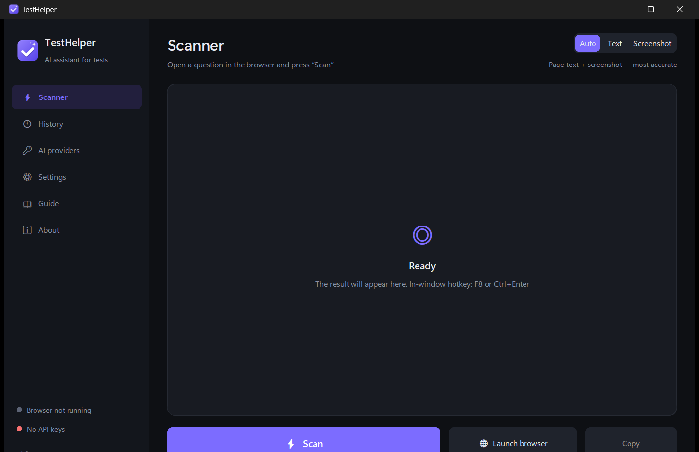
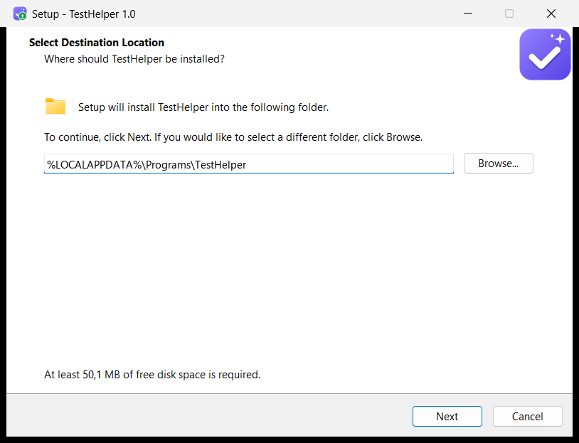

<div align="center">


# TestHelper

**A Windows AI assistant that reads the test question from your browser tab<br>and shows the answer, a confidence score and a short explanation.**

[](../../releases/latest)


[**⬇ Download the installer**](../../releases/latest) · [Features](#-features) · [Usage](#-usage) · [Build from source](#-build-from-source)



</div>

---

## ✨ Features

- **One click, one answer.** The app grabs the text and a screenshot of the active tab, sends them
  to an AI and shows the answer option, a confidence percentage and an explanation.
- **Three scan modes:** *Auto* (text + screenshot, most accurate), *Text* (fastest),
  *Screenshot* (for images and formulas).
- **5 free AI providers** with automatic failover: Gemini, Groq, OpenRouter, Mistral, Cerebras.
  When one runs out of quota, the request quietly moves on to the next.
- **Your own providers and models**: any OpenAI-compatible API (OpenAI, DeepSeek, xAI, Together)
  plus local Ollama / LM Studio without a key.
- **No chromedriver**: works with Chrome, Edge or Brave directly over the DevTools Protocol.
- **History**, **system tray**, **F8 / Ctrl+Enter** hotkey, always-on-top mode.
- **UI in three languages** (English, Ukrainian, Russian), dark and light themes.
- **Portable mode**: keep all data next to the app.

## 🚀 Installation

1. Download `TestHelper-1.0-Setup.exe` from [**Releases**](../../releases/latest).
2. Run it. No administrator rights needed: it installs for your user only (or for everyone, if you choose).

<div align="center">

</div>

The installer automatically uses your Windows display language (English, Ukrainian or Russian)
and falls back to English for any other language.

> [!NOTE]
> Windows SmartScreen may warn about an unknown publisher because the installer isn't code-signed.
> Click **More info → Run anyway**.

## 🧭 Usage

1. Open **AI providers** and add at least one free API key (links below).
2. On the **Scanner** page click **Launch browser**. A separate Chrome / Edge / Brave profile opens
   that the app can talk to.
3. Open the page with the question in it and click **Scan** (or press **F8**).

### Free API keys

| Provider   | Get a key                                                      | Notes                              |
|------------|----------------------------------------------------------------|------------------------------------|
| Gemini     | [aistudio.google.com](https://aistudio.google.com/app/apikey)  | best quality, understands images   |
| Groq       | [console.groq.com](https://console.groq.com/keys)              | very fast, generous limits         |
| OpenRouter | [openrouter.ai](https://openrouter.ai/settings/keys)           | dozens of `:free` models, backup   |
| Mistral    | [console.mistral.ai](https://console.mistral.ai/api-keys)      | Experiment tier, understands images|
| Cerebras   | [cloud.cerebras.ai](https://cloud.cerebras.ai)                 | ultra-fast text models             |

> [!TIP]
> Add keys from 2–3 **different** providers. Gemini limits are per Google project,
> so several keys from the same project don't add quota.

### How failover works

- providers are tried in your order; within each one, from the best model to the fallback,
  rotating through your keys;
- on `429` only that key + model pair is paused (for `Retry-After`); after the daily quota runs out
  the pair rests for an hour, and an invalid key is disabled;
- a model that hangs (timeout) is put aside for 10 minutes;
- the model list is fetched from the provider's API every time, so renamed models don't break the app.

## 🔒 Privacy

- Keys, history and logs are stored **locally only**: `%APPDATA%\TestHelper`
  (next to the `.exe` in portable mode).
- Page content is sent only to the AI provider whose key you added.
- No telemetry, no third-party servers.

## 🛠 Build from source

Requires **Python 3.10+** on Windows.

```powershell
git clone https://github.com/426F6864616E/TestHelper.git
cd TestHelper
pip install -r requirements.txt
python main.py
```

Build the `.exe` and the installer (needs [Inno Setup 6](https://jrsoftware.org/isinfo.php),
`winget install JRSoftware.InnoSetup`):

```powershell
powershell -ExecutionPolicy Bypass -File installer\build.ps1
```

Output: `dist\TestHelper\TestHelper.exe` and `dist\installer\TestHelper-1.0-Setup.exe`.
Regenerate the installer icon with `python installer\make_setup_icon.py`.

**Portable mode:** put an empty file named `portable` next to `TestHelper.exe`.

<details>
<summary><b>Project structure</b></summary>

```
main.py                  entry point, single instance
app/
  ai/providers.py        provider registry and model ranking
  ai/client.py           HTTP client, error classification
  ai/router.py           failover, cooldowns, stats
  browser/cdp.py         Chrome DevTools Protocol (no chromedriver)
  core/config.py         typed settings, atomic writes
  core/scanner.py        browser → prompt → AI → JSON answer
  core/history.py        history in history.json
  ui/                    CustomTkinter UI, tray, pages
locales/                 en / ua / ru
installer/               Inno Setup script, icons, build.ps1
```

</details>

## ⚠️ Responsible use

TestHelper is meant as a study aid: to check yourself and learn from the explanation.
Don't use it where the rules forbid it (exams, certifications, etc.). AI answers can be wrong.

## ☕ Support

If you find the app useful, donation addresses are on the **About** page.

## 📄 License

[MIT](LICENSE)
